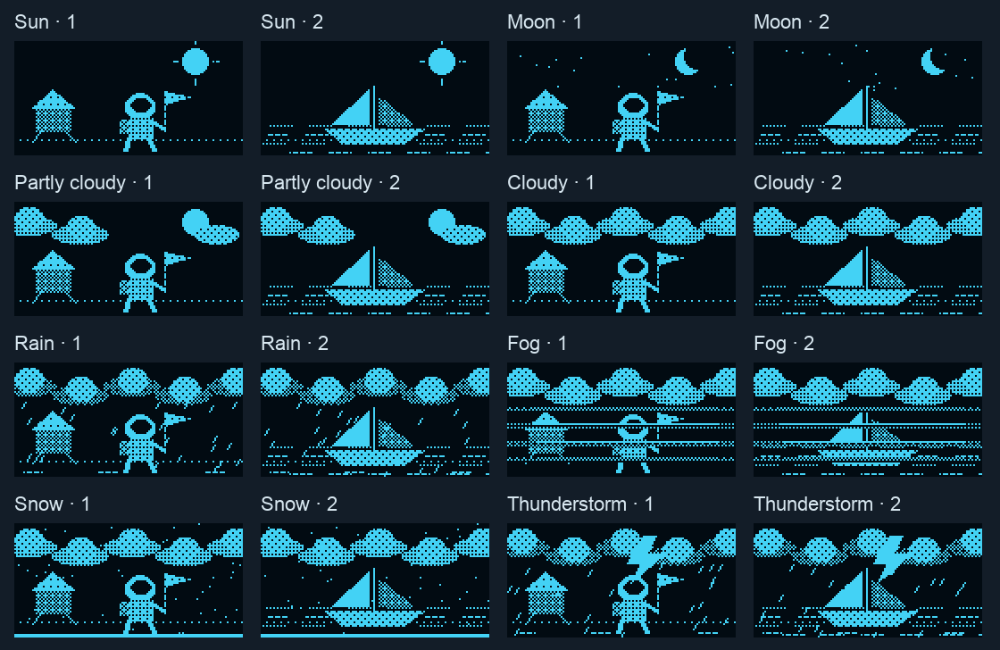

# Weather keychain

A small keychain that shows your city's weather as pixel art, with the temperature in °F.

It uses a **XIAO ESP32-C6** and a **128×64 SSD1306 OLED screen**.

## Pixel art



A few of the built-in scenes, shown in the OLED’s blue color.

## The case

[Download the FreeCAD file](cad/Block-Print-Only.FCStd). It has just two parts: **Front** and **Rear**.

- Open it in FreeCAD and export each part for printing.
- Use M3 heat-set inserts that are 4 mm tall.
- The screw heads sit inside recesses in the case.
- Check the fit before a final print. Battery thickness and USB port clearance use estimates.

## Connect the screen

| Screen pin | C6 pin |
|---|---|
| VCC | 3V3 |
| GND | GND |
| SDA | D10 / GPIO18 |
| SCL | D9 / GPIO20 |

## Build and upload

Install Arduino CLI and these board/library versions:

- ESP32 board package: **3.3.11**
- Adafruit SSD1306: **2.5.17**
- Adafruit GFX: **1.13.0**
- ArduinoJson: **7.4.3**

Install any dependencies they ask for, too. Run these commands from the project folder:

```sh
arduino-cli compile --fqbn esp32:esp32:XIAO_ESP32C6:PartitionScheme=huge_app firmware/KeychainWeather
arduino-cli upload --fqbn esp32:esp32:XIAO_ESP32C6:PartitionScheme=huge_app --port YOUR_PORT firmware/KeychainWeather
```

Replace `YOUR_PORT` with the board's USB port.

## Set up the weather

1. Follow the Wi-Fi instructions on the OLED.
2. Connect to the keychain's setup network.
3. Open **http://192.168.4.1/**.
4. Enter your Wi-Fi name, password, and city or postal code.
5. Add a full state or country after a comma if several places share the name.

The keychain saves the settings. If the city is unclear or not found, setup opens again. Older firmware installations may need setup again after updating.

Use the USB serial monitor for these commands:

| Command | Action |
|---|---|
| `w` | Open setup or change the city |
| `u` | Refresh the weather |
| `p` | Show device status |

## What it does

- Gets weather from [Open-Meteo](https://open-meteo.com/) every **15 minutes**.
- Changes the picture every **minute**.
- Picks from **148 scenes** that match the weather.
- Uses every scene in a weather group before repeating. Restarting resets the order.
- Turns off Wi-Fi between updates. The screen stays visible while the processor sleeps when idle without a USB serial connection.

Battery life has not been measured yet.

## Turn your picture into pixel art

The [Python helper](firmware/image_to_array.py) runs on your computer.

**Picture → crop to 128×64 → edge-aware pixel art → on/off pixels → C++ array**

Install these Python packages:

```sh
python -m pip install pillow numpy opencv-python
```

Run this Python code from the project folder:

```python
from firmware.image_to_array import image_to_array

print(image_to_array("picture.jpg"))
```

It prints **1,024 bytes** of C++ image data. Each bit turns one OLED pixel on or off.

To put the picture in the weather rotation, replace one picture's bytes in [LandscapeArt.h](firmware/KeychainWeather/LandscapeArt.h), then build and upload again. The [code guide](firmware/KeychainWeather/README.md#custom-image-details) shows which entries belong to each weather type and explains the conversion options.

The helper uses the method from [edge-aware-pixel-art](https://github.com/bam-project/edge-aware-pixel-art). It does not upload pictures to a website or directly to the keychain.

## Files and license

- [Firmware and code guide](firmware/KeychainWeather/README.md)
- [Two-part FreeCAD case](cad/Block-Print-Only.FCStd)
- [Python image helper](firmware/image_to_array.py)
- [MIT license](LICENSE)
- [Library and weather-data credits](THIRD_PARTY_NOTICES.md)
